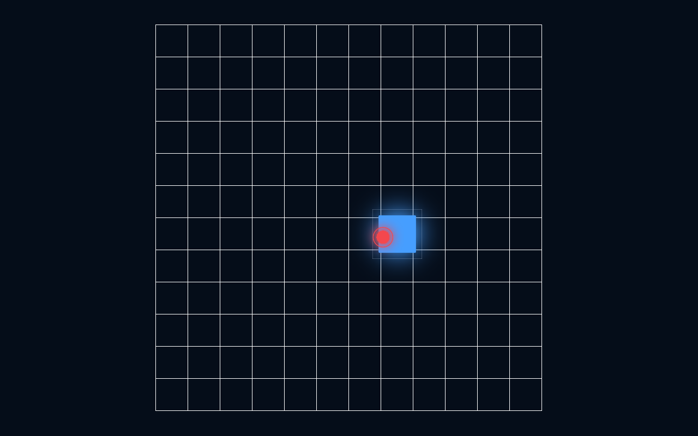
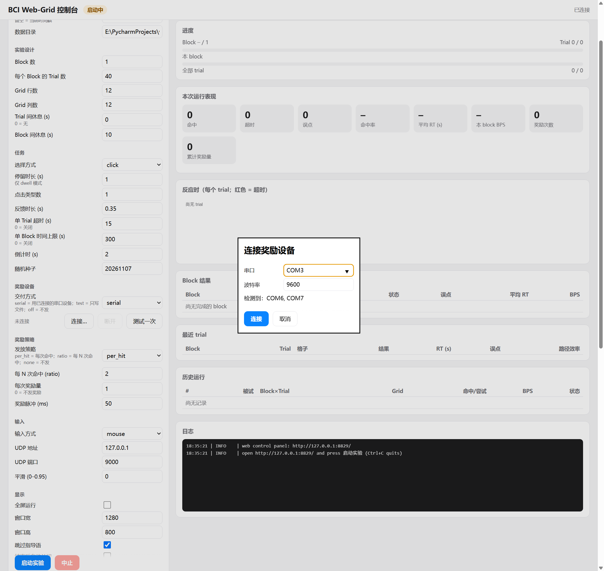
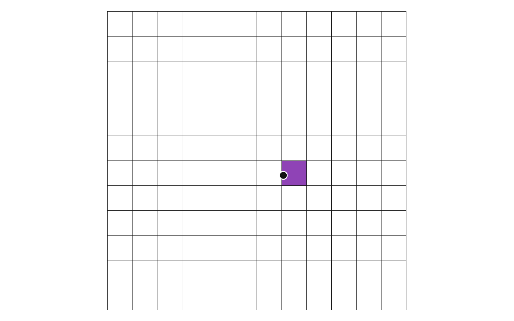

# BCI Web-Grid（PsychoPy）

一个基于 **PsychoPy** 的 BCI **web-grid** 离散目标选择范式。屏幕显示网格，每次高亮一个目标格；被试通过 BCI 解码器（LSL）、鼠标或串口摇杆移动光标，并用点击或停留完成选择。程序记录行为数据、计算信息传输率（BPS），并可向 EEG/BCI 采集系统发送事件标记。

> 本仓库负责**刺激呈现、输入接入、行为记录和事件标记**，不包含 EEG 解码算法。解码器可以发布 LSL 速度流，把光标速度和点击发送进来。



## 环境

- Python **3.11**（`pyproject.toml` 限定 `>=3.11,<3.12`，`.python-version` 为 `3.11`）
- [uv](https://docs.astral.sh/uv/)
- PsychoPy `2026.2.5`（由 `uv.lock` 锁定）
- Windows 10/11（默认中文字体为 `Microsoft YaHei`）

```powershell
uv sync
uv run webgrid --version
```

`pylsl`（LSL 标记与速度输入）和 `loguru`（日志）已是默认依赖，`uv sync` 即可安装；监控/控制页面只用 Python 标准库，不需要额外组件。

## 快速开始（Web 控制台）

所有操作都在浏览器里完成：填参数 → 启动 → 实时监控。运行 `webgrid` 会启动本地控制台（默认 `http://127.0.0.1:8765/`，自动打开浏览器），在页面上点“启动实验”才开始，结束后可以直接改参数再跑一次，无需重启。

```powershell
uv run webgrid                                   # 打开控制台，等你在页面上点启动
uv run webgrid --config configs/default.toml     # 用配置文件预填参数
uv run webgrid --no-open-dashboard               # 只启动服务、不自动开浏览器
```

页面左侧是参数表（被试、block 数、每 block trial 数、grid 行列、trial 间休息、选择方式、输入源、LSL 等），右侧实时显示：网格中的当前目标与光标、block/trial 进度、命中/超时/误点/命中率/RT/BPS、反应时图、每个 block 的结果、最近 trial、历史运行和日志。“中止”按钮等同于按 Esc。

输入方式下方的“输入设备”卡片会显示当前模式；点“配置…”只弹出该模式需要的参数（演示速度 / 摇杆串口等 / LSL 流参数），不再把摇杆和 LSL 的细节平铺在参数表里。

非默认参数会显示来源标签（配置文件、`lab.toml`、CLI 或 WebUI）；点“重置为启动配置”可恢复启动时读到的值。



其它启动方式：

```powershell
# 不改参数，直接用命令行参数立即开始（仍可在页面上监控）
uv run webgrid --run-now --input demo --targets 8 --auto-exit

# 完全不用网页
uv run webgrid --no-dashboard --input mouse --lsl

# 串口 Hall 摇杆 / LSL 速度解码器
uv run webgrid --input joystick --joystick-port COM4
uv run webgrid --input lsl --lsl-velocity-stream WebGridVelocity
```

点“启动实验”（或 `--run-now`）后，范式窗口立即进入倒计时并开始试次；需要和 EEG 对齐时勾选“发布 LSL 标记”（或 `--lsl`）。

数据默认写入 `data/<subject>/ses-<timestamp>/`。

命令行也支持对应的主要参数，例如 `uv run webgrid --run-now --blocks 3 --trials 20 --rows 8 --cols 10`。

## 界面风格

默认 **12×12** 网格，参照 Neuralink Webgrid 的视觉语言：

- 白色底板 + 细黑网格线，不留单元格间隙；
- **动物模式默认不显示任何文字**：无指导语、无计时、无 BPS/NTPM、无目标进度、无错误数、无图例、无提示语；
- 多键模式也不显示文字图例，目标颜色本身就是按键线索；
- 目标格为纯色块：`click_types=1` 时蓝色；`=2` 时蓝/橙；`=3` 时蓝/橙/紫；
- 蓝色 = 左键、橙色 = 右键、紫色 = 中键；目标颜色就是要求按下的键；
- 光标为黑点白描边；鼠标悬停单元格浅灰高亮，误点单元格短暂闪红；
- 倒计时只显示中央注视点 `+`；结束后为空白屏，保存路径只打印在实验者控制台。




修改默认网格：

```powershell
uv run webgrid --rows 10 --cols 10
```

## 范式流程

1. 启动后直接进入准备阶段：网格 + 中央注视点，无文字。
2. 注视点保持 `countdown_seconds` 秒（默认 2 s），随后出现第一个目标。
3. 每个试次：
   - 随机高亮一个目标格（单键模式为蓝色；多键模式按目标颜色区分所需按键），光标保留在上一帧位置；
   - 被试移动光标到目标格；
   - **click** 模式：按下与目标颜色对应的鼠标/BCI 按键；**dwell** 模式：在目标格内连续停留 `dwell_time` 秒自动选择。
4. 命中：目标短暂反馈后出现下一个目标。
5. 点错：目标保留，可继续尝试；仅用视觉反馈（光标/单元格闪红），不显示文字。
6. 超时（默认 15 s）或达到 `targets` 个目标 / `max_seconds` 后结束。
7. 结束后显示空白屏；实验者按空格或 Esc 退出，数据路径打印在控制台。

网格默认 **12×12**；`--rows/--cols` 可调。目标序列使用洗牌袋（每个格子在一个袋内出现一次），避免连续重复，同时保证空间覆盖均衡。

## 数据中的计分（界面不显示）

设：

- `N = rows × cols`：网格格子数
- `C = click_types`：点击类型数（1–3）
- `H`：命中数，`M`：误点次数，`T`：超时数
- `net = H − M`：净正确目标数

则：

```text
每目标信息量 = log2(N × C)                       （bit/target）
NTPM          = net / duration_min                （targets/min，可为负）
BPS           = log2(N × C) × max(net, 0) / t     （bit/s）
```

`BPS` 采用 Nuyujukian et al. 2021（*Technical Report 01: GPT-BCIs*）Eqn. 2 的
achieved-bitrate 定义：`B = log2(N) × max(S_c − S_i, 0) / t`。论文里写作 `log2(N − 1)`，
是因为其中有一个符号是 delete 键；web-grid 没有 delete 键，因此直接使用 `log2(N)`。
`max(…, 0)` 保证误点多于命中时 BPS 为 0，而不是负数（NTPM 仍保留原值，可为负，便于分析）。

示例：12×12、`click_types=1`、120 s 内 20 次命中、1 次误点：

```text
net = 19, NTPM = 9.5, bits/target = log2(144) ≈ 7.17, BPS ≈ 1.14
```

> 注意：`click_types` 同时决定“目标颜色/要求按键”和计分信息量。设为 1 时只有蓝色目标和 1 号键；设为 2 时目标为蓝/橙，必须分别按左/右键；设为 3 时增加紫色中键。按错键计一次 misclick，目标保留。

## 串口 Hall 效应摇杆

```powershell
uv run webgrid --input joystick --joystick-port COM4 --joystick-baud 9600
```

实验室摇杆是 USB 转串口的 HZL Hall 效应手柄（RS232/RS422/RS485），不是 HID 手柄，所以走串口协议而不是 `psychopy.hardware.joystick`。默认 **9600 8N1**、通用 9 字节帧：

```text
FF YYH YYL XXH XXL ZZH ZZL Button CH
```

- `YY/XX/ZZ` 为大端原始轴值，中心 `0x0200`，范围 `0x0030–0x03D0`；Z 轴保留不用；
- `Button` 的 bit 5 是扳机，作为 1 号点击上报（因此 click 和 dwell 两种选择都可用）；
- `CH` 是除 `FF` 外各字节之和的低 8 位。校验失败会丢帧并自动重新同步。

常用参数：

| 参数 | 默认 | 说明 |
| --- | --- | --- |
| `--joystick-port` | 空 | 串口，如 `COM4`；`input=joystick` 时必填 |
| `--joystick-baud` | 9600 | 波特率 |
| `--joystick-address` | 0 | 0 = 通用 9 字节帧；1–64 = 总线寻址 10 字节帧 |
| `--joystick-mode` | `periodic` | `periodic`（周期上报）或 `on_change`（变化上报） |
| `--joystick-speed` | 560 | 满偏速度（px/s），按窗口尺寸换算成归一化速度 |
| `--joystick-deadzone` | 0 | 中心死区（归一化，0–0.95） |
| `--joystick-invert-x` / `--joystick-invert-y` | 关 | 轴反向 |
| `--joystick-center` | 关 | 打开串口时发送“以当前位置为中心”的校准命令 |
| `--joystick-stale-after` | 0.4 | `periodic` 模式超过该时长无帧就停住光标（不保持最后速度） |

串口读取在后台线程完成，渲染循环只排空队列，不会阻塞。`status()` 会给出帧数、无效帧、丢帧、延迟和 stale 状态。

> 扳机固定映射为 **1 号键**。`click_types > 1` 时摇杆无法产生 2/3 号键，请改用 `selection = "dwell"`，或使用支持多键的 LSL/鼠标输入。

## LSL 速度解码器

```powershell
uv run webgrid --input lsl --lsl-velocity-stream WebGridVelocity
```

外部解码器发布一个 LSL 流；必须**同时匹配名称 `WebGridVelocity` 和类型 `Velocity`** 才会连接。只匹配名称或只匹配类型都不会连接，这样不会误连到同名的其他类型流。每个样本是浮点数组：

```text
[timestamp, vx, vy, button?]
```

- `vx/vy`：归一化窗口单位/秒，`+x` 向右、`+y` 向上，`1.0` = 每秒半个窗口；
- `timestamp`：信息字段，实际按接收时刻打时间戳；
- `button`（可选第 4 通道）：0 = 松开，1/2/3 = 点击，只在上升沿产生一次选择；
- 流中断超过 `--lsl-velocity-stale-after`（默认 1 s）后状态标 stale，光标不再移动。

| 参数 | 默认 | 说明 |
| --- | --- | --- |
| `--lsl-velocity-stream` | `WebGridVelocity` | 流名称 |
| `--lsl-velocity-type` | `Velocity` | 必须匹配的流类型 |
| `--lsl-velocity-timeout` | 5 | 名称+类型匹配的总超时（秒） |
| `--lsl-velocity-stale-after` | 1.0 | 多久没有样本算 stale |

最小的发送端（Python，需要 `pylsl`）：

```python
from pylsl import StreamInfo, StreamOutlet
import time

info = StreamInfo("WebGridVelocity", "Velocity", 3, 100, "float32", "demo")
outlet = StreamOutlet(info)
while True:
    outlet.push_sample([0.0, 0.5, 0.0])  # [timestamp, vx, vy]
    time.sleep(0.01)
```

`input=lsl` 时如果启动阶段找不到流，会直接报“no LSL velocity stream found”，不会带着空输入开始实验。

## 事件标记（EEG/BCI）

### LSL 标记

```powershell
uv run webgrid --lsl --lsl-stream WebGridMarkers
```

LSL 流为 `type="Markers"`、单通道 `int32`、`nominal_srate=0`；适合 LabRecorder、OpenViBE、MNE-LSL 等。

### LSL 状态流（在网页上启动）

事件码只描述“发生了什么”，状态流则持续推送“当前是什么状态”，其他 LSL 客户端不必解码事件码：

1. 打开控制台页面，在右上角“LSL 状态流”卡片里确认流名（默认 `WebGridState`）和频率（默认 10 Hz）；
2. 点“启动”后卡片显示 `已启用 · 实验开始时打开流，结束后关闭`；
3. 点“停止”则彻底关掉，之后每次运行都不再发布。

**生命周期：流只在实验运行期间存在，结束页一出现立即关闭。**

| 时刻 | 流状态 |
| --- | --- |
| 已启用、实验未开始 | 不存在（不会产生任何数据） |
| 点“启动实验” | 立即创建，按频率推送；样本 `status=running` |
| **结束页出现的同一帧** | 补推最后一条样本（`phase=done`、`final=true`），随即关闭流；不等窗口关闭/数据收尾 |
| 中止（Esc / 页面“中止”） | 同上，最后一条样本带 `final=true` |
| 下一次运行 | 用同样的流名重新创建 |

结束后不会再有任何数据；客户端在实验开始后 resolve 即可连上，实验结束时 `pull_sample` 会返回 `None`（流已结束）。

⚠️ 如果同时用 LabRecorder 记录这个流，流消失会被视为该流结束（对应记录文件收尾）。需要连续记录时，请只录 EEG 的流，或把状态流的开关留到实验结束之后再关。

也可以在启动时就自动启用（同样是“运行时才开流”）：

```powershell
uv run webgrid --lsl-state
uv run webgrid --lsl-state --lsl-state-stream MyRig --lsl-state-rate 20
```

流属性：`name` 默认 `WebGridState`、`type="WebGrid"`、单通道 `string`、`nominal_srate=0`（不规则推送）。每个样本是一段 JSON：

```json
{
  "schema": "webgrid.state/1", "utc": "2026-11-07T17:12:31.245+08:00",
  "status": "running",              // idle | running | stopping
  "phase": "run",                   // starting|intro|countdown|run|feedback|iti|rest|done
  "subject": "sub-01", "session_id": "20261107-171124",
  "blocks": 2, "trials_per_block": 6, "block": 1, "trial": 3,
  "target": {"index": 3, "row": 5, "col": 6, "label": "r6c7", "button": 1},
  "dwell_progress": 0.0, "elapsed_s": 2.5, "fps": 60.1,
  "hits": 3, "timeouts": 0, "misclicks": 0,
  "last_trial": {"block": 1, "trial": 3, "cell": "r6c7", "outcome": "hit", "rt": 0.135, "misclicks": 0, "path_efficiency": 1.0},
  "event_markers": false,
  "final": false                    // true = 最后一条，随后流关闭
}
```

客户端示例（Python / pylsl）：

```python
import json, pylsl
streams = pylsl.resolve_byprop("name", "WebGridState", timeout=10)  # 实验开始后
inlet = pylsl.StreamInlet(streams[0]); inlet.open_stream()
while True:
    sample, ts = inlet.pull_sample(timeout=5)
    if sample is None:      # 实验结束，流已关闭
        break
    state = json.loads(sample[0])
    print(ts, state["status"], state["phase"], state["block"], state["trial"], state["target"])
```

MATLAB（`lsl_loadlib`）、Unity、C#、C++ 等任何 LSL 客户端都能同样读取，只是把字符串解析成 JSON。

配置文件中对应 `lsl_state` / `lsl_state_stream` / `lsl_state_rate`。状态流由控制台进程发布（`--no-dashboard` 模式下没有），事件标记流仍由每次实验按 `--lsl` 决定。

### 事件码

| code | event | 说明 |
| ---: | --- | --- |
| 1 | `session_start` | 第一个目标出现前 |
| 3 | `block_start` | 每个 block 开始 |
| 4 | `block_end` | 每个 block 结束（含中止时的未完成 block） |
| 10 | `target_onset` | 新目标实际显示（`win.flip()` 之后） |
| 20 | `hit` | 命中 |
| 30 | `misclick` | 误点（目标继续） |
| 40 | `timeout` | 当前目标超时 |
| 2 | `session_end` | 正常结束 |
| 90 | `session_abort` | Esc / 异常中止 |

目标出现标记在 `win.flip()` 返回之后发送，反应时也从该 flip 的时间戳计算。LSL 标记通过网络传输，严格 EEG 同步建议同时做硬件/光电校验，或把标记输出扩展到并行口/采集卡。

## 奖励系统（双策略）

奖励被拆成两个互不影响的策略轴：

| 轴 | 决定什么 | 选项 | 由谁实现 |
| --- | --- | --- | --- |
| **发放策略** `--reward-policy` | **什么时候给、给多少** | `per_hit`（默认，每次命中）/ `ratio`（每 N 次命中，FR-n）/ `none`（从不） | [reward/policy.py](<src/web_grid_paradigm/reward/policy.py>) |
| **交付策略** `--reward` | **怎么送出去** | `serial`（默认，串口给 Arduino）/ `test`（写文件不发硬件）/ `off`（丢弃） | [reward/sink.py](<src/web_grid_paradigm/reward/sink.py>) |

两个模块**互不依赖**：`policy` 只产出 `Reward(amount, duration_ms, reason)`，`sink` 只负责把它送出去；两者唯一汇合点是 `runner`/`reporter`。因此可以单独替换任一侧，也可以单独 import 使用：

```python
from web_grid_paradigm.reward.policy import build_reward_policy
from web_grid_paradigm.reward.sink import build_reward_sink
```

两者任意组合，例如“每 3 次命中给一次、但先不接硬件”：

```powershell
uv run webgrid --reward test --reward-policy ratio --reward-ratio 3
```

| 发放策略 | 行为 |
| --- | --- |
| `per_hit` | 每次 trial **命中**（点中目标且按键正确，或 dwell 达标）立即发一次 |
| `ratio` | 命中累计到第 N 次才发（`--reward-ratio N`）；误点/超时不计数、不发 |
| `none` | 从不发（纯行为实验） |

误点、超时、block/会话结束都**不**发奖励；奖励时间戳就是该 trial 结束（点击或停留达成）的时刻，写在 `rewards.csv` 的 `monotonic_s` 里。策略是纯函数式的：只看到已结束的 trial，返回“发不发、发多少”，自己维护计数器（每场会话重置）。

| 交付策略 | 说明 |
| --- | --- |
| `serial`（默认） | 每次奖励通过串口给 Arduino 发一行 ASCII 指令 |
| `test` | 不发硬件，把**将要发送的原始字节**写入会话目录的 `reward_out.txt` 并打日志——接硬件前用它验证协议 |
| `off` | 丢弃奖励，同时不写 `rewards.csv`（不虚报奖励） |

默认串口参数：`COM3`、9600 波特；串口打不开时会**自动降级为 `test` 并报 ERROR**，实验照常跑完（不会因为没插 Arduino 丢掉会话）。

```powershell
# 接到真实 Arduino
uv run webgrid --reward serial --reward-port COM3 --reward-baud 9600

# 没有硬件时先验证协议（推荐先用这个跑一遍）
uv run webgrid --reward test
```

### 设备参数放在 lab.toml（推荐）

实验设计放 `--config`，串口/LSL/奖励硬件放机器本地的 `--lab-config`：

```powershell
uv run webgrid `
  --config configs/default.toml `
  --lab-config configs/lab.toml
```

`lab.toml` 只接受设备相关键（串口、波特率、LSL 流、奖励硬件等），写错实验字段会直接报错，避免一台机器的配置悄悄改变实验设计。复制示例：

```powershell
copy configs\lab.example.toml configs\lab.toml     # 只在本机保留
```

`--lab-config` 可以写成平铺键，也可以放在 `[device]` 小节：

```toml
[device]
joystick_port = "COM4"
joystick_baud = 9600
lsl_velocity_stream = "WebGridVelocity"
lsl_velocity_type = "Velocity"
reward_port = "COM3"
```

优先级：**默认值 → `--config` → `--lab-config` → `configs/reward.toml` / `--reward-config` → 命令行参数**。所以临时换端口不用改文件。

### 硬件参数放在单独的 TOML 里（也可以只用一个文件）

串口号是按机器不同的，**如果**你希望实验设计随仓库走、硬件只留在本机，就把示例文件复制一份填好：

```powershell
copy configs\reward.example.toml configs\reward.toml     # 只在本机保留
```

`configs/reward.toml` 存在时，`webgrid` 启动会**自动加载**它（日志会打印 `reward hardware settings loaded from ...`）；也可以用 `--reward-config 其他文件.toml` 指定。文件里只允许奖励相关键（写错键名会直接报错，避免静默改错）：

```toml
reward = "serial"           # serial | test | off
reward_port = "COM3"
reward_baud = 9600
reward_policy = "per_hit"   # per_hit | ratio | none
reward_ratio = 2
reward_amount = 1
reward_duration_ms = 50
```

**不需要两个文件**：单个 `--config` 文件里也可以直接写 `reward*` 键，或用一个 `[reward]` 小节把硬件参数分开写：

```toml
# configs/session.toml —— 一个文件搞定
subject = "sub-07"
rows = 8
cols = 10
blocks = 2
targets = 5

[reward]
reward = "serial"
reward_port = "COM9"
reward_baud = 115200
reward_policy = "ratio"
reward_ratio = 3
```

```powershell
uv run webgrid --config configs/session.toml
```

三种用法等价、按需选择：

| 用法 | 适合场景 |
| --- | --- |
| 单个 `--config`（含 `reward*` 或 `[reward]`） | 单机、参数就一套 |
| `--config` 范式 + 自动加载的 `configs/reward.toml` | 多台机器共用同一份实验设计，各自配硬件 |
| `--config` + `--reward-config 文件` | 同一台机器多套硬件（例如两套 Arduino） |

优先级：**默认值 → `--config` → `--lab-config` → `configs/reward.toml`（或 `--reward-config`）→ 命令行参数**。所以临时换端口不用改文件：`uv run webgrid --reward-port COM9`。

### 在网页里连接与选择奖励方式

网页里的奖励分成两组：

**奖励设备**（外接设备）

- 交付方式：`serial`（用已连接的串口设备）/ `test`（只写文件，不发硬件）/ `off`（不发）
- 一行状态 + 三个按钮 `[连接…] [断开] [测试一次]`，状态**随交付方式变化**，串口只在 serial 下才有意义：

| 交付方式 | 状态行 | 连接按钮 |
| --- | --- | --- |
| `serial` 未连接 | `未连接` | 可用 |
| `serial` 已连接 | `已连接 COM3 @ 9600 baud · 已发送 N 次` | 可用（“重新连接…”） |
| `test` | `test 模式：只写入 reward_out.txt，不使用串口` | 禁用 |
| `off` | `奖励已关闭，不发送` | 禁用（“测试一次”也禁用） |

- 点“连接…”弹出对话框，只需填**串口**和**波特率**（串口协议是内置固定格式，不需要、也不允许在界面上改）：

  ```
  串口       COM3          （下拉列出检测到的端口，也可手输）
  波特率     9600
  检测到：COM6, COM7
  ```

- 连接是**面板级**的：一次连接，之后每次运行都复用，**实验结束不会断开**；点“断开”才关闭；
- 对话框打开时会用上一次（或配置文件）的端口/波特率/模板预填；切到 `test` / `off` 时旧的连接不受影响，只是不会被用到。

**奖励策略**（每场实验）

- 发放策略：`per_hit` / `ratio` / `none`
- 每 N 次命中（ratio）、每次奖励量、奖励脉冲时长

“测试一次”不启动实验，直接用已连接设备发一次脉冲，成功后显示实际指令，例如 `已发送：R 1 50（serial COM3）`；未连接且交付方式为 `serial` 会明确报错，便于排查接线。

服务端接口（也可给其他程序调用）：

| 方法 | 路径 | 作用 |
| --- | --- | --- |
| POST | `/api/reward/connect` | `{"port":"COM3","baud":9600}` 打开设备（失败返回 400 + 原因） |
| POST | `/api/reward/disconnect` | 关闭设备 |
| POST | `/api/reward/test` | 用已连接设备发一次脉冲（未连接且非 test 模式时报错） |
| GET | `/api/state` | 含 `reward_device`：连接状态、端口、波特率、已发送/失败次数、检测到的串口 |

配置文件（`configs/reward.toml` / `--reward-config` / `[reward]`）里的端口、波特率只是**默认值**：弹窗里改了就按弹窗的来，不改则沿用配置。串口指令模板是**内置固定**的，不提供配置项。

**串口协议**（内置固定，不可配置）：

```
R 1 50
```

即每个命中发送 `R` + 奖励量 + 脉冲毫秒数 + 换行，格式写死在 [reward/sink.py](<src/web_grid_paradigm/reward/sink.py>) 的 `WIRE_COMMAND`（需要改协议时改这一行，例如只发一个字节 `"1"`），没有配置项。

Arduino 侧最小示例：

```cpp
void setup() { Serial.begin(9600); pinMode(REWARD_PIN, OUTPUT); }
void loop() {
  if (!Serial.available()) return;
  String line = Serial.readStringUntil('\n');      // "R 1 50"
  int amount = 1, ms = 50;
  if (sscanf(line.c_str(), "R %d %d", &amount, &ms) == 2) {
    digitalWrite(REWARD_PIN, HIGH); delay(ms); digitalWrite(REWARD_PIN, LOW);
  }
}
```

说明：

- 奖励在 trial 命中时由**发放策略**决定是否触发，再由**交付策略**送出；`reward_amount = 0` 也等于关闭。
- 串口写入在**独立线程**里完成，渲染循环不会因为 UART 阻塞而掉帧。
- 每次奖励都会写 `rewards.csv` 和 `events.csv`（事件名 `reward`），两个文件互为校验；`test` 模式还多一份 `reward_out.txt` 保存原始字节。
- 网页控制台分“奖励设备”（交付方式 + 连接弹窗里的串口/波特率）与“奖励策略”（策略、N、奖励量、脉冲时长）两组，实时面板显示**奖励次数 / 累计奖励量 / 当前通道与策略**。
- 新增发放策略只需实现 `on_trial()`（返回 `Reward` 或 `None`）并注册进 `POLICIES`；新增交付方式只需实现 `deliver()` / `close()`。

## 数据文件

```text
data/
└── sub-01/
    └── ses-20261107-140000/
        ├── config.json      # 全部参数、参数来源、Python/PsychoPy 版本、平台
        ├── events.csv       # 事件日志：session/target/click/hit/reward/timeout...
        ├── trials.csv       # 每个目标一行（命中或超时）
        ├── rewards.csv      # 每次奖励一行（amount/duration/reason/sink）
        ├── reward_out.txt   # 仅 reward=test：原始的串口字节
        ├── summary.json     # 汇总指标 + 配置快照 + 版本
        └── session.log      # loguru 运行日志（DEBUG 级）
```

- CSV 为 UTF-8 with BOM，方便 Excel 直接打开中文；JSON 为 UTF-8。
- `events.csv` 同时记录 `monotonic_s`（PsychoPy 时钟）与 `utc`；便于和 EEG 记录做时间对齐。
- `trials.csv` 字段包括：目标格 `target_row/target_col`、要求按键 `required_button`、`onset_s/offset_s/rt_s`、`outcome`、`misclicks`、`path_px/straight_px/path_efficiency` 等。
- `path_efficiency = 直线距离 / 实际轨迹长度`，没有移动时为空白。
- 多 block：`events.csv` 与 `trials.csv` 都有 `block` 列，`trial_index` 在每个 block 内从 1 开始；`summary.json` 的 `results.blocks` 为每个 block 的结果，顶层为全部 block 合计（NTPM/BPS 按 block 内时长计算，不含休息）。
- 流程：倒计时 → block 1 → 空白休息 → 倒计时 → block 2 → …；各 block 目标序列不同但由 `seed` 决定、可复现。
- 一个 block 内：目标 → 选中/超时 → 反馈（`--feedback`）→ trial 间休息（`--iti`，空网格）→ 下一个目标；最后一个 trial 之后不再休息，直接结束 block。`events.csv` 记录 `iti_start`；反应时仍从目标真正出现（flip）开始计时，不含休息时间。
- 按 Esc 中止时仍会写出已产生的数据，`summary.json` 中 `aborted` 为 `true`。
- 同一秒内重复启动会自动加 `-2`、`-3` 后缀，不覆盖已有数据。

## 常用参数

| 参数 | 默认 | 说明 |
| --- | --- | --- |
| `--subject` | `sub-01` | 被试标签，进入目录名 |
| `--session` | 时间戳 | 会话标签 |
| `--output-dir` | `data` | 数据根目录 |
| `--seed` | `20261107` | 目标序列随机种子 |
| `--rows`, `--cols` | 12, 12 | 网格尺寸（2–40，需足够分辨率） |
| `--blocks` | 1 | block 数 |
| `--trials`（别名 `--targets`） | 40 | 每个 block 的 trial（目标）数 |
| `--block-rest` | 10 | block 之间的空白休息（秒） |
| `--max-seconds` | 300 | 单个 block 的时间上限；0 关闭 |
| `--run-now` | 关 | 用命令行参数立即开始（不等待页面上点启动） |
| `--no-dashboard` / `--dashboard` | 开 | 是否启动 Web 控制台 |
| `--dashboard-port` | 8765 | 控制台端口（0 = 随机空闲端口） |
| `--dashboard-host` | `127.0.0.1` | 绑定地址；`0.0.0.0` 允许局域网访问 |
| `--no-open-dashboard` / `--open-dashboard` | 自动打开 | 是否自动打开浏览器 |
| `--selection` | `click` | `click` 或 `dwell` |
| `--dwell-time` | 1.0 | 停留选择时长（秒） |
| `--trial-timeout` | 15 | 单目标超时；0 关闭 |
| `--click-types` | 1 | 1–3；目标颜色/要求按键，同时影响计分 |
| `--feedback` | 0.35 | 命中/超时反馈时长 |
| `--iti` | 0 | trial 间休息（秒）：反馈之后只显示空网格和光标、不显示目标；0 为无 |
| `--countdown-seconds` | 2.0 | 倒计时总时长 |
| `--input` | `mouse` | `mouse` / `demo` / `joystick` / `lsl` |
| `--demo-speed` | 2.2 | autopilot 速度 |
| `--joystick-port` | 空 | 摇杆串口（`input=joystick` 时必填） |
| `--joystick-baud` | 9600 | 摇杆波特率 |
| `--joystick-address` | 0 | 0 = 通用帧；1–64 = 总线地址 |
| `--joystick-mode` | `periodic` | `periodic` / `on_change` |
| `--joystick-speed` | 560 | 满偏速度（px/s） |
| `--joystick-deadzone` | 0 | 归一化死区，0–0.95 |
| `--joystick-invert-x/y` / `--no-joystick-invert-x/y` | 关 | 轴反向 |
| `--joystick-center` / `--no-joystick-center` | 关 | 打开时发送中心校准命令 |
| `--joystick-stale-after` | 0.4 | 无帧超时（秒） |
| `--lsl-velocity-stream` | `WebGridVelocity` | LSL 速度流名称 |
| `--lsl-velocity-type` | `Velocity` | 必须匹配的流类型 |
| `--lsl-velocity-timeout` | 5 | LSL 名称+类型匹配的总超时（秒） |
| `--lsl-velocity-stale-after` | 1.0 | 无样本超时（秒） |
| `--fullscreen` | 开 | 全屏（默认） |
| `--windowed` | 关 | 强制窗口模式（调试） |
| `--window-width/height` | 1280/800 | 窗口尺寸（`--windowed` 时生效） |
| `--screen` | 0 | 显示器索引 |
| `--show-cursor` / `--hide-cursor` | 关 / 开 | 显示或隐藏操作系统光标 |
| `--language` | `zh` | `zh` / `en` |
| `--font` | `Microsoft YaHei` | 文字字体 |
| `--lsl` / `--no-lsl` | 关 | 发布/不发布 LSL 事件标记流 |
| `--lsl-stream` | `WebGridMarkers` | 事件标记流名称 |
| `--lsl-state` / `--no-lsl-state` | 关 | 控制台启动时是否自动推送 LSL 状态流 |
| `--lsl-state-stream` | `WebGridState` | 状态流名称 |
| `--lsl-state-rate` | 10 | 状态流推送频率（Hz，0.5–100） |
| `--reward` | `serial` | 交付策略：`serial` / `test` / `off` |
| `--reward-policy` | `per_hit` | 发放策略：`per_hit` / `ratio` / `none` |
| `--reward-ratio` | 2 | `ratio` 策略的 N（每 N 次命中给一次） |
| `--reward-port` | `COM3` | Arduino 串口 |
| `--reward-baud` | 9600 | 串口波特率 |
| `--reward-amount` | 1 | 每次命中的奖励量（0 = 不发） |
| `--reward-duration-ms` | 50 | 奖励脉冲时长（毫秒） |
| `--reward-config` | `configs/reward.toml`（存在时） | 硬件配置 TOML（端口/波特率等） |
| `--lab-config` | 空 | 本机设备 TOML（串口、LSL、奖励硬件） |
| `--debug` | 关 | 调试：DEBUG 日志、完整堆栈 |
| `--log-file` | 空 | 额外写一份滚动日志文件（每个会话目录总会有 `session.log`） |
| `--instructions` | 关 | 显示人用指导语页；动物实验保持关闭 |
| `--no-instructions` | 开 | 跳过指导语（默认） |
| `--auto-exit` / `--no-auto-exit` | 关 | 空白结束屏 2.5 s 后是否自动关闭 |

配置文件示例见 [`configs/default.toml`](configs/default.toml)，命令行参数会覆盖文件中的同名字段。例如：

```powershell
uv run webgrid --config configs/default.toml --input joystick --joystick-port COM4
```

## 测试与开发

```powershell
uv run pytest
uv run webgrid --screenshot docs/preview.png   # 视觉检查
```

项目结构（按职责分层：核心逻辑不依赖 PsychoPy，渲染层不依赖网页层）：

```text
src/web_grid_paradigm/
├── __init__.py          # 版本号等包元数据
├── __main__.py          # python -m web_grid_paradigm
├── lsl_api.cfg          # 随包分发的 liblsl 日志配置
├── app/                 # 应用编排 / 组合根
│   ├── cli.py           # 入口：main / _run / _serve / _preview
│   ├── cli_args.py      # 命令行参数定义、配置合并（TOML+CLI）
│   ├── log.py           # loguru 配置、PsychoPy 日志桥接
│   └── runner.py        # 会话编排：窗口、block 流程、主循环
├── core/                # 纯 Python：参数、几何、试次、计分、文案、监控协议
│   ├── config.py        # 参数与校验、TOML 读写
│   ├── geometry.py      # 网格布局、像素/归一化坐标、目标洗牌袋
│   ├── i18n.py          # 中英文 UI 文案
│   ├── monitor.py       # 监控协议 + 空实现（核心不依赖网页层）
│   ├── scoring.py       # BPS/NTPM 统计、跨 block 合并
│   └── session.py       # 试次状态机（纯 Python）
├── presentation/        # PsychoPy 窗口、刺激、颜色与绘制
│   ├── palette.py       # 颜色
│   ├── window.py        # PsychoPy 窗口创建
│   ├── stimuli.py       # 所有视觉刺激对象（一次性构建）
│   └── renderer.py      # 逐帧绘制 + 误点/光标反馈
├── velocity_inputs/     # 输入策略 + 门面
│   ├── router.py        # 选策略 + 积分 + 目标注入
│   └── ...              # base/registry/integrator/mouse/demo/joystick/hall_protocol/lsl
├── recording/           # 数据与事件输出
│   ├── recorder.py      # CSV/JSON 数据写入
│   ├── reporter.py      # 所有输出：CSV、事件标记、面板状态
│   ├── markers.py       # 事件码、LSL 标记
│   └── lsl.py           # LSL 出口（事件标记 / 状态流）、liblsl 配置
├── reward/              # 奖励子系统：两个独立模块
│   ├── policy.py        # 何时给：per_hit / ratio / none（返回 Reward 决策）
│   └── sink.py          # 怎么送：serial / test / off（把决策送到硬件）
└── panel/               # Web 控制台
    ├── __init__.py      # 对外导出
    ├── schema.py        # 参数表单描述与校验
    ├── state.py         # 运行队列、实时快照、SessionView
    ├── server.py        # HTTP 路由、SSE、页面资源（`/` 新界面、`/assets/*`）
    ├── lsl_state.py     # LSL 状态流推送线程
    └── static/          # Vue 控制台的构建产物（由 webui/ 生成，随 wheel 分发）
```

前端：`webui/` 用 Vue 3 + TypeScript + Vite + Naive UI 编写控制台，构建产物写入
`src/web_grid_paradigm/panel/static/`，由控制台在根路径 `/` 提供。开发/构建见
[webui/README.md](<webui/README.md>)。

依赖方向：`core` 不依赖 PsychoPy；`presentation` 和 `velocity_inputs` 只依赖 `core`；`recording` 依赖 `core`/`reward`；`reward` 只依赖 `core`；`app` 是唯一同时依赖所有子系统的组合根；`panel` 依赖 `core`/`reward`/`recording`，不依赖 `app.runner`。

## 注意事项

- **Python 版本**：项目固定为 3.11（`uv.lock` 中的解释器也是 3.11）。如果系统只有 3.12，`uv sync` 会提示安装/选择 3.11；可先 `uv python install 3.11`。
- **字体**：默认 `Microsoft YaHei`。macOS/Linux 请用 `--font` 指定系统里可显示中文的字体，或 `--language en`。
- **显示器校准提示**：首次启动可能看到 `Monitor specification not found`；这是 PsychoPy 未找到显示器校准文件，本范式使用像素坐标，不依赖该设置，可忽略。
- **全屏与缩放**：默认全屏；本地调试用 `--windowed`。正式采集建议把 Windows 显示缩放设为 100%，避免像素坐标与刷新率偏差。
- **时序**：目标出现时间取 `win.flip()` 的返回时间；请确认显示器刷新率和垂直同步。PsychoPy 的浮点渲染精度足够行为实验，但毫秒级 EEG 对齐仍建议硬件/光电校验。
- **网格密度**：格子最小 8 px；40×40 需要足够大的窗口/分辨率，否则会报“grid is too dense”。
- **输入设备**：`input=joystick` 在启动时会打开串口，端口/波特率错误会直接中止；`periodic` 模式超过 `--joystick-stale-after` 没有帧时会停住光标。`input=lsl` 在启动时按名称+类型解析流，匹配不到会报错，可先用 `--lsl-velocity-timeout` 调整总等待时间。
- **数据安全**：每次事件即时 flush；程序崩溃/按 Esc 时仍保留已写入的数据，但不会补写未完成的试次。
- **范围**：本仓库不采集 EEG、不做解码、不实现 P300 行列闪烁；它是 web-grid 行为范式与 BCI 输入/标记的接口层。

## 参考

- [Neuralink Webgrid](https://neuralink.com/webgrid/)：web-grid 任务与 BPS 计分说明
- [PsychoPy 文档](https://www.psychopy.org/)
