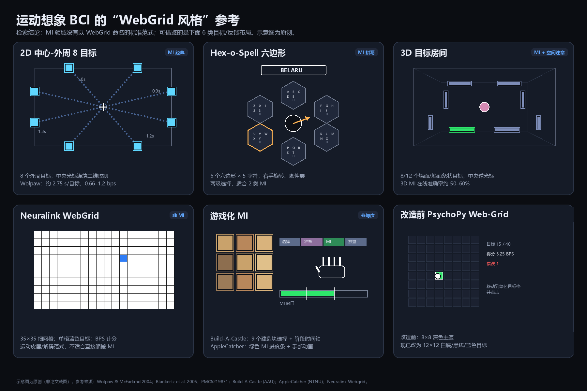

# 运动想象（MI）里的 “WebGrid” 样式调研

> 调研日期：2026-11-07。示意图见 [`mi-webgrid-styles.png`](mi-webgrid-styles.png)（原创绘制，不是论文截图）。

## 结论先行

1. **公开检索中未发现以 “WebGrid” 命名的 MI 标准范式。** 检索到的 “WebGrid” 主要是两种无关的东西：
   - **Neuralink Webgrid**：运动皮层/侵入式 BCI 的网格点击游戏，35×35 格、1–3 种点击、按 BPS 计分，不是 MI 范式；
   - **WebGrid（Gaines & Shaw）**：心理学 repertory grid（个人构念格）工具，与 BCI 无关。
2. MI 领域真正接近“网格选择”的样式主要是：**中心-外周多目标**、**Hex-o-Spell 六边形**、**3D 目标房间**，以及**游戏化反馈界面**；此外还有大量研究使用**固定 cue 的左右手/双脚实验范式**，那才是 MI 训练/校准的“标准界面”。
3. 直接把 Neuralink 的 35×35 网格搬到 MI 不合适：经典 MI 光标研究多在 **0.5–1.5 bps** 量级，而 35×35 细网格要求高速、精确的连续光标控制；MI 更适合 **2–4 类、4–9 个大目标、1–2 s 停留** 的选择方式。

## 六类可借鉴样式

### 1. 2D 中心-外周 8 目标：最接近 MI 的“网格”

- **布局**：屏幕四周放 8 个黑色方块目标（上/下/左/右各 2 个），光标从中心出发，二维连续移动；每个目标旁标注到达时间（0.9–1.5 s），屏幕中显示运动轨迹。
- **交互**：不是“点选”，而是用 SMR（mu/beta）调制控制光标连续靠近目标；进入目标即命中。Wolpaw & McFarland 2004 的经典 8 目标中心-外周任务，平均 2.75 s/目标，82% 到达率，严格 ITR 约 0.66 bps。
- **可借鉴**：目标数少、目标大、中心-外周对称、时间标签；不要一开始就做满屏细网格。
- **来源**：
  - [Wolpaw & McFarland 2004, PNAS](https://doi.org/10.1073/pnas.0403504101)
  - [Kübler, Nijboer & Birbaumer 2007 章节 PDF（图 22.4）](http://www.ece.uprm.edu/~manian/toward%20brain%20computer%20interfacing.pdf)
  - [ITR Atlas 对该任务的整理](https://tangemicioglu.com/itr-atlas/interfaces/wolpaw-mcfarland-2004-cursor/)

### 2. Hex-o-Spell 六边形：2 类 MI 也能做“多目标选择”

- **布局**：中央一个圆，周围 6 个相邻六边形；每个六边形放 5 个字符 + “返回”；顶部显示已输入文本（如 `BELARU`），中央灰色箭头指示当前选择。
- **交互**：**右手运动想象**让箭头顺时针旋转；**脚运动想象**让箭头向外伸展，指向某个六边形后选中；进入下一级后，6 个六边形重新分配字符。只用 2 类 MI，却能完成 30 个字符的选择。
- **可借鉴**：如果你的 MI 分类器只有 2–3 类，六边形/环形分层选择比自由二维光标更稳；用“旋转 + 伸展”替代“上下左右”。
- **来源**：
  - [Sensors 2014 综述（含 Hex-o-Spell 图 4）](https://pmc.ncbi.nlm.nih.gov/articles/PMC4029701/)
  - Blankertz et al. 2006, *The Berlin Brain-Computer Interface presents the novel mental typewriter Hex-o-Spell*.

### 3. 3D 目标房间：8/12 个墙面条状目标

- **布局**：第一人称暗色房间，墙面/地面分布 8 或 12 个条状目标，中央一个粉色小球作为光标；目标条用高亮颜色（黄/绿）标出。
- **交互**：同时使用**外显空间注意 + 运动想象**做 3D 光标控制；在线准确率约 50–60%（8 目标约 50–60%，12 目标略低）。
- **可借鉴**：3D 能增加目标数量，但会显著增加控制难度；如果做 MI，不建议一开始上 3D，除非研究问题就是 3D 控制。
- **来源**：
  - [PMC6219871 / IEEE TBME 2018 图 3](https://pmc.ncbi.nlm.nih.gov/articles/PMC6219871/figure/F3/)
  - DOI: 10.1109/TBME.2018.2872855

### 4. 游戏化 MI：Build-A-Castle / AppleCatcher

- **Build-A-Castle**：3D 城堡游戏；顶部是阶段时间轴（选择 → 准备 3 s → MI 5 s → 放置），左侧是 **3×3 共 9 个建造块**的选择面板；MI 成功时出现手部动画和魔法粒子，粒子大小/颜色表示分类置信度。
- **AppleCatcher**：苹果树 + 下落苹果 + 屏幕底部的双手；绿色进度条上有两条竖线标出 MI 窗口，分类结果控制虚拟手接苹果，顶部显示分数。
- **可借鉴**：把“MI 置信度”做成连续进度条/粒子，而不是只有成功/失败；用 3×3 图标面板而不是 35×35 字符网格；失败也给中性反馈（裂纹砖块），避免挫败。
- **来源**：
  - [Build-A-Castle MI BCI（AAU）](https://vbn.aau.dk/ws/files/717521442/MED10_G11.pdf)
  - [AppleCatcher（NTNU，Brain Informatics 2025）](https://dl.acm.org/doi/10.1007/978-981-95-9578-5_9)
  - [AppleCatcher workshop PDF](https://www.dropbox.com/scl/fi/45k7tcd0emad304mfvluz/The-AppleCatcher-Game_BCI-workshop_2025.pdf?rlkey=hs9monqf03zmh7tgp67irl0w9&e=1&dl=0)

### 5. 标准 cue-based MI：不是网格，但必须保留

- **布局**：黑屏 → 注视点 → 左/右/双脚箭头或图片 cue（约 2 s）→ 运动想象（约 4 s）→ 休息（约 2 s）；通常没有光标，只有 cue 和进度条。
- **交互**：固定试次、固定时序、固定类别；这是绝大多数 MI 数据集和校准阶段的标准样式（例如 64 通道、左/右/双脚各 10 trial/block）。
- **可借鉴**：把“校准/训练”与“在线网格任务”分开。不要用游戏网格替代 cue 训练，否则分类器没有稳定标签。
- **来源**：
  - [2022 世界机器人大赛 MI 赛题说明（2 s cue + 4 s MI + 2 s rest）](https://www.worldrobotconference.com/uploads/admin/202206/62a1b216c7478.pdf)

### 6. Neuralink WebGrid：可以借“视觉”，不要借“规模”

- **布局**：白色背景、细黑网格、单个蓝色方块目标；官方页面可选 35×35 格、1–3 种点击类型；得分 BPS 由净命中/分钟、网格大小、点击类型数推导。
- **交互**：运动皮层解码 + 光标点击；临床参与者 >10 BPS。它不是 MI，也不适合直接作为 MI 的难度基准。
- **可借鉴**：极简的“网格 + 单目标高亮 + 顶部状态”视觉；不要照搬 35×35 的密度和点击类型计分。
- **来源**：
  - [Neuralink Play Webgrid](https://neuralink.com/webgrid/)

## 如果要把当前 PsychoPy 项目改成 MI 版

### 推荐布局

| 场景 | 网格 | 目标数 | 选择方式 | 说明 |
| --- | --- | --- | --- | --- |
| 校准/训练 | 无网格 | 2–4 类 cue | 固定试次 | 左/右手、双脚、舌头；2 s cue + 4 s MI + 2 s rest |
| 2 类 MI 在线 | 3×3 或 1×4 | 3–9 | 停留 1–2 s / 步进 | 左右手映射左右移动，或六边形旋转/伸展 |
| 3–4 类 MI 在线 | 3×3 | 9 | 二维步进 + 停留 | 左/右/上/下映射四方向；目标数不要超过 9 |
| 连续 2D SMR | 中心-外周 | 8 | 光标连续移动 | 经典 Wolpaw 样式，目标在四周 |
| 游戏化 | 3×3 图标 | 9 | 停留/置信度阈值 | 参考 Build-A-Castle 的 9 块面板 |

### 视觉与试次建议

- **背景**：深色 `#0b0d12`；非目标格 `#1b2130`；目标 `#2ee66b` 或 `#61a8ff`；文字 `#e8ecf6`。高对比、低饱和，避免 MI 窗口内出现闪烁/动画干扰。
- **目标大小**：4×4 网格目标约占屏宽 20%；8×8 约 10–11%；35×35 只有约 2–3%，对 MI 太小。建议 MI 网格不超过 4×4（最多 5×5）。
- **试次结构**：注视 1.0–1.5 s → cue 1.0–1.25 s → MI 3–4 s → 反馈 1–2 s；每个 block 8–12 个目标，避免疲劳。
- **反馈**：目标高亮 + 底部进度条/粒子；不要用“只有成功才反馈”，否则 MI 学习信号不足。
- **光标**：2 类 MI 用步进式（每次移动一格/半格）或停留选择；不要要求 MI 连续高速控制。
- **计分**：保留 BPS 便于和 webgrid 对比，但 MI 论文更常报告 **accuracy、完成时间、ITR**；4×4、80% 准确率、4 s/目标的理想上限约 1.2 bps，实际通常更低。

### 对当前代码的最小改动路径

1. 在 `configs/default.toml` 增加 `mi_mode = "cue" | "grid"`、`mi_classes = 2 | 3 | 4`、`mi_cue_seconds`、`mi_imagery_seconds`、`mi_rest_seconds`。
2. 新增 `mi_cue.py`：绘制注视点、左/右/双脚箭头、MI 进度条；按固定时序发 marker（cue onset、MI start/end）。
3. 在 `psychopy_runner.py` 增加 `state="mi_cue"` 分支；校准阶段只跑 cue 试次，不显示网格。
4. 在线阶段保留现有网格/光标/停留逻辑，把输入源换成 MI 分类器的 UDP 输出（离散类别或二维速度）。
5. 先在 3×3 网格、9 个目标、1.5 s 停留上验证；再考虑 4×4 或六边形布局。

## 参考来源

1. Neuralink. *Play Webgrid*. https://neuralink.com/webgrid/
2. Wolpaw, J. R., & McFarland, D. J. (2004). Control of a two-dimensional movement signal by a noninvasive brain-computer interface in humans. *PNAS*, 101(51), 17849–17854. https://doi.org/10.1073/pnas.0403504101
3. Kübler, A., Nijboer, F., & Birbaumer, N. (2007). Brain-computer interfaces for communication and motor control—perspectives on clinical applications. In *Toward Brain-Computer Interfacing* (pp. 373–391). MIT Press. [PDF](http://www.ece.uprm.edu/~manian/toward%20brain%20computer%20interfacing.pdf)
4. Blankertz, B., et al. (2006). The Berlin Brain-Computer Interface presents the novel mental typewriter Hex-o-Spell. [综述图 4](https://pmc.ncbi.nlm.nih.gov/articles/PMC4029701/)
5. 3D MI + overt spatial attention: *IEEE TBME* 2018, 65(11), 2417–2427. [PMC6219871](https://pmc.ncbi.nlm.nih.gov/articles/PMC6219871/)
6. Nielsen, J. H. L., Klebæk, K. J. S., & Pedersen, M. D. W. *Build-A-Castle MI BCI*. Aalborg University. [PDF](https://vbn.aau.dk/ws/files/717521442/MED10_G11.pdf)
7. Skredsvig, E., Kneider, R., & Molinas, M. *The AppleCatcher Game: A Novel Motor Imagery BCI for Hand Rehabilitation*. NTNU. [Brain Informatics 2025](https://dl.acm.org/doi/10.1007/978-981-95-9578-5_9)
8. 世界机器人大赛 BCI 脑控机器人大赛. *运动想象赛题说明*. [PDF](https://www.worldrobotconference.com/uploads/admin/202206/62a1b216c7478.pdf)
9. Gaines, B. R., & Shaw, M. L. G. *Using WebGrid in Your Research and Teaching*（心理学 repertory grid，与 BCI 无关）. [PDF](https://gaines.library.uvic.ca/pdf/NAPCN02B.pdf)
10. ITR Atlas. *Sensorimotor-Rhythm 2D Cursor BCI (Wolpaw & McFarland, 2004)*. https://tangemicioglu.com/itr-atlas/interfaces/wolpaw-mcfarland-2004-cursor/
